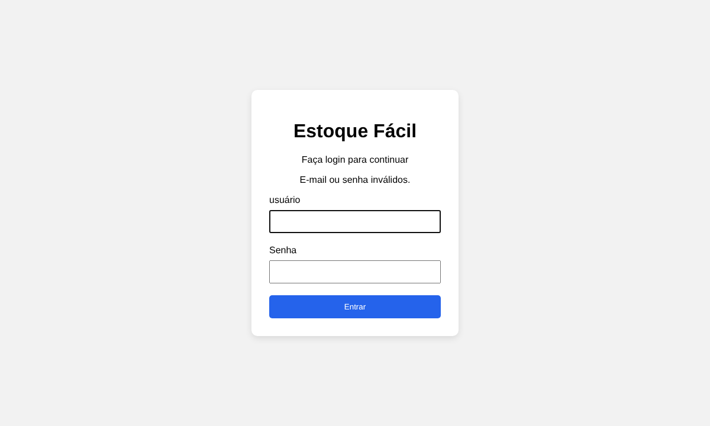
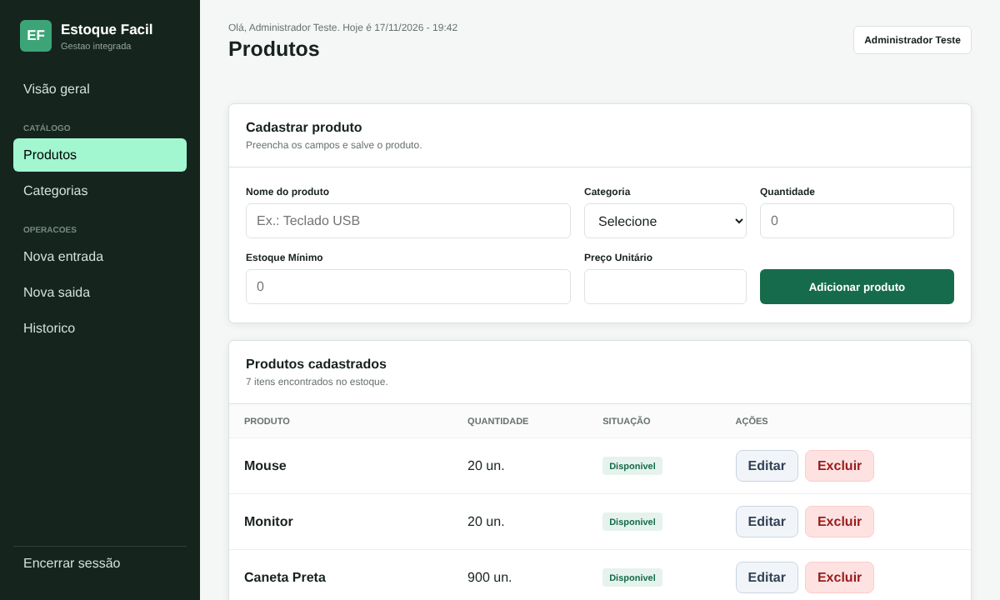
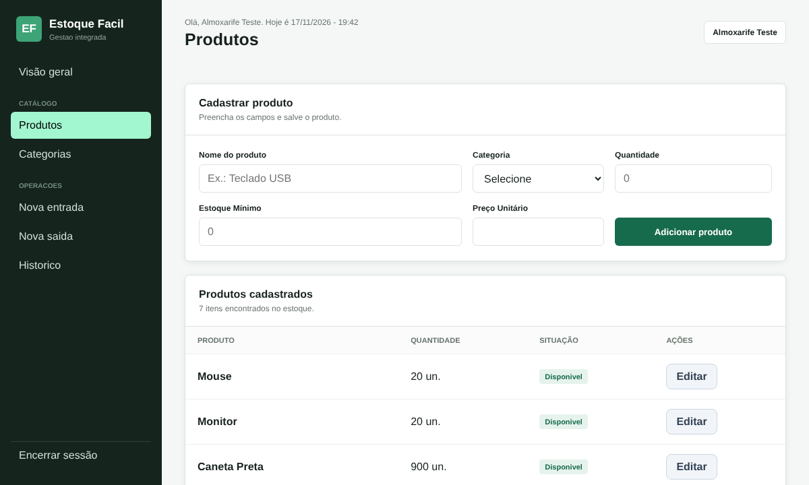
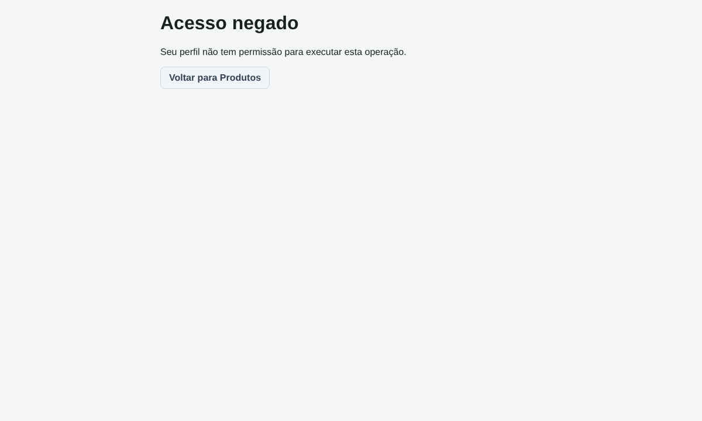

# Estoque Fácil — Autenticação e controle de acesso (Atividade N3)

**Disciplina:** Linguagem de Programação — ADS, 2º semestre — FASIPE Sorriso
**Dupla:** Maria Luiza Figueiredo Correa e **[NOME DO(A) COLEGA — preencher]**
**Repositório:** https://github.com/Jon4s118/n3_linguagem

## 1. Instalação

1. Iniciar **Apache** e **MySQL** no XAMPP.
2. Copiar o conteúdo desta pasta para `C:\xampp\htdocs\estoque\` (o `index.php` deve ficar direto nessa pasta).
3. No phpMyAdmin, criar/selecionar o banco `estoque_ads` (utf8mb4_unicode_ci).
4. **Banco novo:** importar `tabelas.sql` (já inclui produtos, categorias, movimentações e o bloco de ajuste da tabela `usuarios`).
5. **Banco que já tem cadastros:** *não reimportar* o SQL antigo. Executar apenas `criar_tabela_usuarios.sql` (ou o bloco de ajuste no final de `tabelas.sql`, se a tabela `usuarios` antiga já existir).
6. Conferir `conexao.php` (host `localhost`, banco `estoque_ads`, usuário `root`, senha vazia).
7. Abrir `http://localhost/estoque/` — a primeira tela é o login.

**Contas fictícias de teste:** `admin@teste.com` / `Admin@123` (administrador) e `almox@teste.com` / `Almox@123` (almoxarife). Senhas são gravadas só como hash (`password_hash`).

## 2. Como funciona

| Passo | Arquivo | O que faz |
|---|---|---|
| Tabela | `criar_tabela_usuarios.sql` | `usuarios` com id, nome, email (único), `senha_hash`, perfil, ativo |
| Login | `login.php`, `autenticar.php` | Formulário POST; `prepare()/execute()`; `password_verify()`; checa `ativo`; `session_regenerate_id(true)`; grava `usuario_id`, `nome` e `perfil` em `$_SESSION` |
| Proteção | `verificar-login.php` | Redireciona para `login.php` sem sessão; incluído em todas as páginas e endpoints (index, produtos, produto, categorias, entrada, saída, histórico, inserir, editar, deletar, movimentação) |
| Permissão | `exigirPerfil()` em `deletar.php` | Só `administrador` exclui; checado **no servidor** (resposta 403), o botão oculto é só interface |
| Logout | `logout.php` | Limpa `$_SESSION`, apaga o cookie e destrói a sessão; o menu "Encerrar sessão" aponta para ele |
| CRUD | `inserir/editar/deletar.php`, `validar-produto.php` | Mantidos com PDO, validação e token CSRF |

**Autenticação** = provar quem é o usuário (e-mail + senha). **Autorização** = o que esse usuário pode fazer (perfil): almoxarife consulta, cadastra e edita; só o administrador exclui.

## 3. Testes realizados

Ambiente: PHP 8.3 e MariaDB 10.11 (equivalente ao do XAMPP), com os usuários de teste acima e 7 produtos já cadastrados.

| # | Teste | Resultado esperado | Resultado |
|---|---|---|---|
| 1 | Abrir `index.php` (e as demais páginas) sem login | Redireciona para `login.php` | OK |
| 2 | Enviar POST direto a `inserir.php`, `editar.php`, `deletar.php`, `movimentacao.php` sem login | Redireciona para `login.php` | OK |
| 3 | Login com senha incorreta / e-mail inexistente | Não autentica; mensagem genérica | OK |
| 4 | Login de usuário com `ativo = 0` | Não autentica | OK |
| 5 | Almoxarife acessa Visão geral, Produtos, Categorias, Entrada, Saída, Histórico | Página abre (200) | OK |
| 6 | Almoxarife cadastra e edita um produto | Salvo no banco | OK |
| 7 | Almoxarife não vê o botão Excluir | Botão ausente | OK |
| 8 | Almoxarife envia POST ou abre `deletar.php` direto | 403 "Acesso negado"; produto permanece | OK |
| 9 | Administrador exclui o produto de teste | Registro removido | OK |
| 10 | Exclusão com token CSRF inválido; cadastro sem token | Operação recusada | OK |
| 11 | Logout e nova tentativa em `index.php`, `produtos.php`, `deletar.php` | Redireciona para `login.php` | OK |
| 12 | Produtos cadastrados antes continuam acessíveis | 7 produtos antes e depois; aparecem na tela | OK |

### Capturas de tela

| | |
|---|---|
|  **1.** Senha incorreta não autentica |  **2.** Administrador vê "Excluir" |
|  **3.** Almoxarife não vê "Excluir" |  **4.** Almoxarife em `deletar.php`: acesso negado |

(Extra: `prints/05_apos_logout_redireciona_login.png` — após o logout, `index.php` volta ao login.)

## 4. Divisão de tarefas

- **Jon4s118:** repositório, tabelas e ambiente; criação da tabela e do login/proteção das páginas (commit "passo 3 e 4").
- **Thonyreisof:** hash de senha, perfis, `autenticar.php`, `logout.php`, permissão de exclusão (commit "passo 5 e 6").
- **Maria Luiza:** correção do campo de login (`name="email"`), proteção das páginas que ficaram abertas (categorias, entrada, saída, histórico, movimentação), cabeçalho com o nome do usuário logado, testes e este relatório.

*(Ajustar esta seção conforme a divisão real da dupla.)*

## 5. Referências

Documentação do PHP (`password_hash`, `password_verify`, `session_regenerate_id`, PDO). Revisão do código, testes automatizados e a redação deste relatório foram feitos com apoio do Claude (Anthropic); o código foi lido e é compreendido pela dupla.
